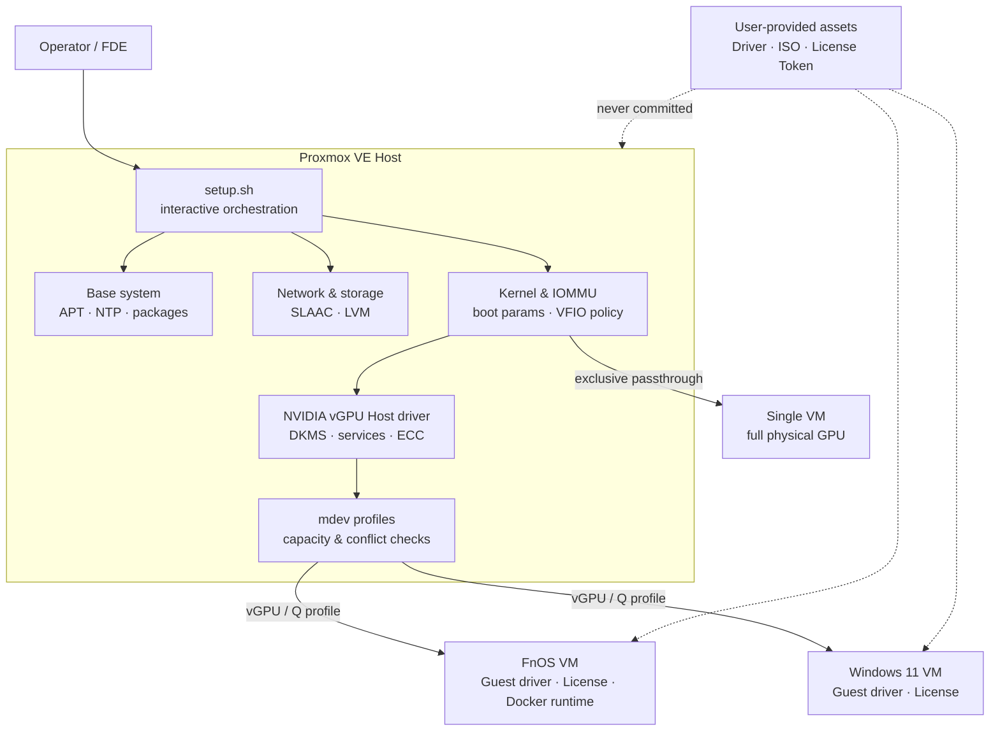

<div align="center">

# Solis PVE Script

**面向 Proxmox VE 9.x 与 Tesla P4 的模块化基础设施自动化工具箱**

将主机初始化、网络与存储、IOMMU、vGPU、FnOS / Windows 11 虚拟机配置，收敛为可审阅、可确认、可恢复的运维流程。

[](https://www.proxmox.com/en/products/proxmox-virtual-environment/overview)


[](LICENSE)

[English README](README_EN.md) · [架构](#架构与集成边界) · [快速开始](#快速开始) · [验证状态](#验证状态) · [限制](#当前限制与非目标)

</div>

> [!IMPORTANT]
> 这不是通用 PVE 安装器，也不是完全无人值守的“一键脚本”。项目面向明确的硬件与版本基线，通过交互式模块、前置检查和人工门禁降低基础设施变更风险。

## 项目价值

PVE GPU 虚拟化不是单点配置问题：引导参数、IOMMU、内核版本、NVIDIA Host / Guest 驱动、mdev profile、License、虚拟机设备模型和容器 runtime 必须协同工作，任一层不匹配都可能表现为“设备可见但 GPU 不可用”。

本项目把这些跨层操作组织成一条可追踪的工程链路：

- **系统集成**：连接 PVE Host、Linux 内核、PCI/IOMMU、Tesla P4、FnOS、Windows 11、NVIDIA vGPU 与 Docker GPU runtime。
- **变更安全**：在网络、存储、直通和 vGPU 配置前执行检测、预览或确认；关键文件备份；profile 替换失败时尝试恢复原配置。
- **显式边界**：区分 vGPU 与整卡直通，区分 Host 驱动、Guest 驱动、License 和 Toolkit 的职责，不在仓库分发受限驱动或凭据。
- **可运维性**：把重启点、兼容性约束、验收命令和人工步骤写入同一套脚本与运行手册。

## 项目概览

| 维度 | 当前范围 |
|---|---|
| 目标环境 | Proxmox VE 9.x / Debian 13 Trixie |
| GPU 路径 | Tesla P4 整卡直通，或 NVIDIA vGPU 16.x / R535 的 mdev 路径 |
| Guest | FnOS Linux VM、Windows 11 VM |
| 自动化形态 | 一个交互式入口 + 10 个可独立执行的 Bash 模块 |
| 外部依赖 | 用户合法获取的 NVIDIA 驱动与 License、FnOS / Windows / VirtIO ISO |
| 公开仓库边界 | 仅包含合规脚本与文档；不包含驱动、Token、证书、私钥或现场凭据 |
| 当前证据等级 | 本地离线验证脚本已提供；可公开的完整运行证据仍待补充 |

## 架构与集成边界



### 责任边界

- **本项目负责**：PVE 配置编排、IOMMU/vGPU 前检、Host 驱动安装入口、mdev 管理、VM 创建和公开运行手册。
- **Guest 侧独立完成**：匹配版本的 Guest 驱动、有效 NVIDIA License、Docker runtime，以及具体应用的 GPU 开关与业务验收。
- **不由本项目提供**：NVIDIA 驱动包、License 服务或 Token、操作系统 ISO、业务容器和生产数据。
- **互斥路径**：同一块 P4 不能同时由 NVIDIA Host 驱动提供 vGPU，又绑定 `vfio-pci` 做整卡直通。

## 核心能力

| 模块 | 工程能力 | 关键保护 |
|---|---|---|
| `01_base.sh` | deb822 APT 源、订阅提示、时区/NTP、基础包、可选温度监控 | 配置备份；第三方监控脚本固定提交并校验 SHA-256 |
| `02_storage.sh` | 删除 `local-lvm`、扩展根卷、调整 `local` 内容类型 | 多次确认；已完成状态可重复检测；明确仅适合已备份的新装环境 |
| `03_network.sh` | `vmbr0` IPv6 SLAAC / `accept_ra=2` | `DRY_RUN`、配置备份、网卡探测、控制台兜底提示 |
| `04_iommu.sh` | Intel IOMMU、引导刷新、vGPU / passthrough 模式、兼容内核 pin | `DRY_RUN`、模式互斥、bootloader 探测、备份与确认 |
| `05_vgpu_driver.sh` | 用户自备 NVIDIA vGPU Host 驱动、DKMS 与基础验证 | nouveau / `vfio-pci` 冲突检查、内核/headers 前检 |
| `06_vgpu_mdev.sh` | vGPU 服务、ECC、mdev profile 与实例容量查看 | 驱动状态检查；ECC 变更后强制提示重启 |
| `07_license.sh` | NVIDIA 官方 CLS / DLS 与 Guest Token 指引 | 不创建第三方 License 服务，不生成或分发 Token |
| `08_vm_attach.sh` | 新增 vGPU，或为已停止 VM 原位替换唯一 profile | 防止误加第二块；容量检查；停机门禁；写后校验与失败回滚 |
| `09_fnos_vm.sh` | 创建 FnOS VM，系统盘虚拟化、数据盘 NVMe PCIe 直通 | VMID 冲突和块设备检查；IOMMU 组独占验证；格式化风险提示 |
| `10_win11_vm.sh` | 创建 UEFI、TPM 2.0、VirtIO Windows 11 VM | ISO / VMID 前检；分离安装、驱动、激活与 vGPU 步骤 |
| `scripts/validate_repo.sh` | Shell 语法、Markdown 本地链接、公开资产边界和全仓空白检查 | 完全离线；不连接或操作 PVE、FnOS、VM、容器和硬件 |

`setup.sh` 只负责编排菜单；每个模块都可单独执行，便于按现场状态分阶段推进和复核。

## 关键工作流

### 1. PVE Host 准备

```text
基础环境 → 存储布局 → 网络/IPv6 → IOMMU 与内核策略
                                └─ 重启并确认目标内核/IOMMU
```

### 2. 选择 GPU 路径

```text
Tesla P4
├─ vGPU：NVIDIA Host driver → mdev profile → VM → Guest driver + License
└─ 直通：vfio-pci → 单个 VM 独占整卡
```

### 3. vGPU Guest 链路

```text
Host driver ready
  → vGPU services / ECC
  → profile capacity check
  → attach or in-place replacement
  → Guest driver
  → Licensed
  → Linux Guest Docker runtime
  → application-specific GPU acceptance
```

容器中能运行 `nvidia-smi` 只证明基础 CUDA/runtime 链路可用；转码或推理服务仍应通过真实任务验收。

## 工程设计与取舍

| 决策 | 原因 | 代价 |
|---|---|---|
| 模块化而非全自动安装 | 内核、存储和 PCI 变更具有不同重启点与风险 | 需要操作者理解顺序并完成现场确认 |
| vGPU / passthrough 显式二选一 | 避免 NVIDIA Host 驱动与 `vfio-pci` 争抢设备 | 切换路径需要重新配置并重启 Host |
| 驱动和 License 不入库 | 满足授权、体积和凭据安全边界 | 使用者必须自行合法获取并校验资产 |
| 网络和 IOMMU 提供 `DRY_RUN` | 先审阅将发生的变更，降低远程失联风险 | 预演不能替代重启后的现场验收 |
| vGPU profile 原位替换 | 保留既有 `hostpci` 参数并避免新增第二块设备 | 要求 VM 已停止且只有一个既有 vGPU |
| Docker 默认 runtime 保持 `runc` | GPU 只由明确申请的容器使用，减少全局影响 | 应用 Compose 仍需单独声明 GPU 能力 |

## 快速开始

### 前置条件

- PVE 9.x Host，并具备 root 权限和本地/带外控制台兜底。
- 已备份重要配置与数据；`02_storage.sh` 会删除 LVM thin pool，不能在不理解影响时执行。
- 合法获取的 NVIDIA vGPU Host / Guest 驱动与有效 License entitlement。
- 创建 VM 时所需的 FnOS、Windows 11 和 VirtIO ISO。
- 先阅读 [vGPU 驱动与 Guest GPU 指南](docs/vgpu-driver-guide.md)。

### 运行交互式入口

```bash
git clone git@github.com:Solismuchengxue/Solis_Pvescript.git
cd Solis_Pvescript
chmod +x setup.sh scripts/*.sh drivers/*.sh
sudo ./setup.sh
```

也可以直接运行单个模块：

```bash
# 先预览网络变更
sudo DRY_RUN=1 ./scripts/03_network.sh

# 预览 vGPU 模式的 IOMMU / 内核变更
sudo MODE=vgpu DRY_RUN=1 ./scripts/04_iommu.sh

# 给没有 vGPU 的 VM 新增 P4-4Q
sudo VMID=101 MDEV_TYPE=nvidia-65 ./scripts/08_vm_attach.sh

# 为已停止 VM 原位替换唯一既有 profile
sudo REPLACE_EXISTING=1 VMID=101 MDEV_TYPE=nvidia-65 ./scripts/08_vm_attach.sh
```

### 常用环境变量

| 变量 | 默认值 | 作用 |
|---|---:|---|
| `MIRROR` | `ustc` | `ustc` / `tuna` / `official` APT 源 |
| `DO_UPGRADE` | `0` | 设为 `1` 时执行 `apt full-upgrade` |
| `TEMP_MONITOR` | `1` | 是否安装经过固定提交与摘要校验的温度监控脚本 |
| `ASSUME_YES` | `0` | 跳过通用确认；高风险环境不建议使用 |
| `DRY_RUN` | `0` | `03`、`04` 中预览而不落盘 |
| `MODE` | `vgpu` | `04` 中选择 `vgpu` 或 `passthrough` |
| `REPLACE_EXISTING` | `0` | `08` 中显式启用既有 vGPU 原位替换 |

## 兼容性基线

以下是仓库当前编码和文档针对的基线，不构成对所有组合的兼容承诺：

| 层级 | 基线 |
|---|---|
| Hypervisor | PVE 9.x / Debian 13 Trixie |
| CPU / platform | Intel VT-d / IOMMU；已记录环境为 Lenovo M920x、i7-8700T、32 GB RAM |
| Network / storage | Intel i226-V、NVMe；脚本默认 `vmbr0`、`local`、`/dev/nvme1n1`，均需现场复核 |
| GPU | Tesla P4 8 GB / Pascal |
| vGPU | 16.x / R535；计算与转码使用 Q profile |
| Profile examples | P4-2Q=`nvidia-64`、P4-4Q=`nvidia-65`，以 Host 实际 `mdev_supported_types` 为准 |
| Guest driver | 必须与 Host 使用匹配的 vGPU 分支和版本；文档示例为 `535.309.01` |
| Container runtime | Linux Guest 推荐 NVIDIA 官方 APT 版 Container Toolkit；文档示例 `1.19.1-1` |

内核与 R535 兼容性高度敏感。`04_iommu.sh` 当前包含兼容内核安装/pin 逻辑，但部分组合仍可能需要与目标驱动匹配的补丁；不要把“脚本执行完成”直接等同于 vGPU 全链路验收通过。

## 验证状态

### 当前公开证据

| 检查 | 结果 | 证据边界 |
|---|---|---|
| Bash 语法 | 13 个跟踪中的 `.sh` 文件通过 `bash -n`（2026-08-09） | 证明语法可解析，不证明 PVE 上运行成功 |
| Git whitespace | `git diff --check` 通过（2026-08-09） | 仅覆盖当前差异格式 |
| README 本地链接 | 2 个专题文档链接存在 | 不验证外部链接和运行内容 |
| 本地仓库验证 | 已提供 | `scripts/validate_repo.sh` 离线检查语法、链接、公开资产边界和空白 |
| ShellCheck | 尚未纳入 | 当前验证不据此声称 lint 通过 |
| 运行验收 | 由各模块和专题文档给出检查命令 | 仓库尚未保存一套完整、脱敏、可复核的运行证据包 |

本地静态复核可执行：

```bash
bash scripts/validate_repo.sh
```

运行时应至少复核：目标内核、IOMMU、PCI 驱动归属、`nvidia-smi`、mdev profile/容量、Guest License、NVIDIA/UVM 设备节点、Docker runtime，以及真实转码或推理任务。

## 文档

- [vGPU Driver & Guest GPU Guide](docs/vgpu-driver-guide.md)：Host / FnOS / Windows Guest 驱动、License、profile 替换和 Linux Guest NVIDIA Container Toolkit。
- [Windows 11 Activation Guide](docs/win11-kms-activation.md)：Retail / OEM / MAK / 组织官方 KMS / Evaluation 等合规激活路径。
- [Repository Design Boundary](DESIGN.md)：public/private 仓库与迁移边界；不是技术架构文档。
- [Offline Repository Validation](scripts/validate_repo.sh)：与 CI 共用的无基础设施副作用静态检查。
- [MIT License](LICENSE)：允许复用、修改和分发，但软件按原样提供且不附带担保。

## 公开仓库中可审阅的作者工作

以当前代码和 Git 历史可验证的范围为准，本项目呈现了以下工作：

- 把 PVE、Linux 内核、PCI/IOMMU、NVIDIA vGPU 与异构 Guest 串成端到端集成流程。
- 为破坏性或版本敏感操作设计前检、确认、预演、备份和回滚策略。
- 将 FnOS 与 Windows 11 的 VM 创建、设备模型、驱动和 License 边界文档化。
- 处理 vGPU profile 容量冲突、重复挂载、停机替换和 Guest 容器 GPU 接入等实际运维问题。
- 在公开仓库中保持驱动、Token、证书和凭据隔离。

仓库当前 Git `HEAD` 记录为单一作者历史；README 不据此虚构客户案例、性能收益、生产规模或雇佣关系。

## 当前限制与非目标

- 项目针对特定 PVE、Tesla P4、网络和存储拓扑，不是跨平台通用安装器。
- `02_storage.sh` 具有数据破坏性，只适用于已理解布局并完成备份的环境。
- 驱动、内核、profile 和 License 必须匹配；升级任一层后都需要重新验收。
- Host 驱动安装流程并未消除所有内核补丁和供应商兼容性风险。
- 不部署或配置 Kokoro-FastAPI、ComfyUI 等业务应用；Toolkit 只打通容器访问 GPU 的基础能力。
- 未启用云端 CI；尚无 ShellCheck、模块行为回归测试和完整的公开运行证据包。
- 本项目不承诺生产 SLA，也不替代变更审批、备份、维护窗口和现场回退计划。
