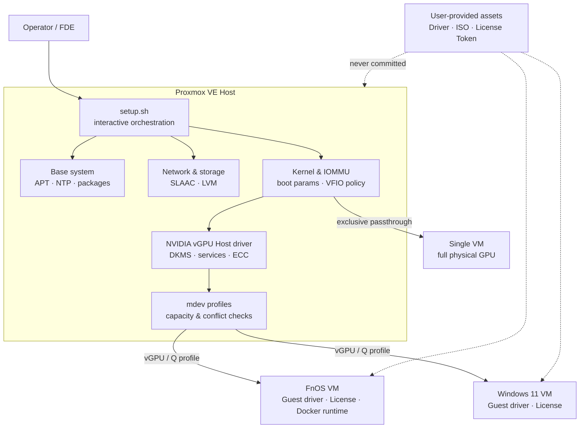

<div align="center">

# Solis PVE Script

**Modular infrastructure automation for Proxmox VE 9.x and NVIDIA Tesla P4**

It turns host initialization, networking, storage, IOMMU, vGPU, and FnOS / Windows 11 VM configuration into reviewable, gated, and recoverable operational workflows.

[](https://www.proxmox.com/en/products/proxmox-virtual-environment/overview)


[中文 README](README.md) · [Architecture](#architecture-and-integration-boundaries) · [Quick Start](#quick-start) · [Verification](#verification-status) · [Limitations](#current-limitations-and-non-goals)

</div>

> [!IMPORTANT]
> This is neither a general-purpose PVE installer nor a fully unattended “one-click” script. It targets an explicit hardware and software baseline and uses interactive modules, preflight checks, and human approval gates to reduce infrastructure change risk.

## Project Value

PVE GPU virtualization is not a single-configuration problem. Boot parameters, IOMMU, kernel versions, NVIDIA Host and Guest drivers, mdev profiles, licensing, VM device models, and container runtimes must work together. A mismatch at any layer can leave the GPU visible to the system but unusable by workloads.

This project organizes those cross-layer operations into a traceable engineering workflow:

- **Systems integration:** connects the PVE Host, Linux kernel, PCI/IOMMU, Tesla P4, FnOS, Windows 11, NVIDIA vGPU, and Docker GPU runtime.
- **Change safety:** performs checks, previews, or confirmations before network, storage, passthrough, and vGPU changes; backs up key configuration; and attempts restoration if a profile replacement fails verification.
- **Explicit boundaries:** separates vGPU from full-device passthrough and distinguishes the responsibilities of Host drivers, Guest drivers, licensing, and the NVIDIA Container Toolkit.
- **Operability:** keeps reboot points, compatibility constraints, acceptance commands, and manual gates in the same scripts and runbooks.

## Project Snapshot

| Dimension | Current scope |
|---|---|
| Target platform | Proxmox VE 9.x / Debian 13 Trixie |
| GPU paths | Tesla P4 full-device passthrough, or NVIDIA vGPU 16.x / R535 via mdev |
| Guests | FnOS Linux VM and Windows 11 VM |
| Automation model | One interactive entry point plus 10 independently executable Bash modules |
| External dependencies | Legally obtained NVIDIA drivers and licensing, plus FnOS / Windows / VirtIO ISOs |
| Public repository boundary | Compliant scripts and documentation only; no drivers, tokens, certificates, private keys, or site credentials |
| Current evidence level | Reviewable implementation and static Shell syntax checks; continuous CI and a complete public runtime evidence package are not yet available |

## Architecture and Integration Boundaries



### Responsibility Boundaries

- **This project covers:** PVE configuration orchestration, IOMMU/vGPU preflight checks, the Host driver installation entry point, mdev management, VM creation, and public runbooks.
- **Guest-side responsibilities:** a matching Guest driver, a valid NVIDIA license, Docker runtime configuration, application-specific GPU enablement, and workload acceptance testing.
- **Not provided:** NVIDIA driver packages, license services or tokens, operating-system ISOs, business application containers, or production data.
- **Mutually exclusive paths:** the same P4 cannot simultaneously serve vGPU workloads through the NVIDIA Host driver and be bound to `vfio-pci` for full-device passthrough.

## Core Capabilities

| Module | Engineering capability | Primary safeguards |
|---|---|---|
| `01_base.sh` | deb822 APT sources, subscription notice handling, timezone/NTP, base packages, and optional temperature monitoring | Configuration backups; pinned third-party monitor commit and SHA-256 verification |
| `02_storage.sh` | Remove `local-lvm`, extend the root volume, and change `local` content types | Multiple confirmations; completed-state detection; explicit fresh-install and backup warning |
| `03_network.sh` | IPv6 SLAAC / `accept_ra=2` on `vmbr0` | `DRY_RUN`, configuration backup, NIC detection, and console fallback guidance |
| `04_iommu.sh` | Intel IOMMU, boot refresh, vGPU / passthrough policy, and compatible-kernel pinning | `DRY_RUN`, mode separation, bootloader detection, backup, and confirmation |
| `05_vgpu_driver.sh` | User-provided NVIDIA vGPU Host driver, DKMS, and baseline verification | nouveau / `vfio-pci` conflict checks and kernel/header preflight checks |
| `06_vgpu_mdev.sh` | vGPU services, ECC handling, mdev profile discovery, and instance capacity | Driver-state checks and a mandatory reboot reminder after ECC changes |
| `07_license.sh` | Official NVIDIA CLS / DLS and Guest token guidance | Does not create third-party license services or generate/distribute tokens |
| `08_vm_attach.sh` | Add a vGPU or replace the only existing profile on a stopped VM | Prevents an accidental second vGPU; checks capacity and VM state; verifies writes and attempts rollback |
| `09_fnos_vm.sh` | Create an FnOS VM with a virtual system disk and NVMe PCIe data-disk passthrough | VMID and block-device checks, exclusive IOMMU-group validation, and formatting warnings |
| `10_win11_vm.sh` | Create a UEFI, TPM 2.0, VirtIO Windows 11 VM | ISO and VMID preflight checks; separates installation, drivers, activation, and vGPU stages |

`setup.sh` is an orchestration menu only. Every module can be run independently, allowing work to proceed in controlled stages based on the current site state.

## Key Workflows

### 1. Prepare the PVE Host

```text
Base system → Storage layout → Network/IPv6 → IOMMU and kernel policy
                                         └─ Reboot and verify kernel/IOMMU
```

### 2. Select a GPU Path

```text
Tesla P4
├─ vGPU: NVIDIA Host driver → mdev profile → VM → Guest driver + License
└─ Passthrough: vfio-pci → one VM exclusively owns the physical GPU
```

### 3. Complete the vGPU Guest Path

```text
Host driver ready
  → vGPU services / ECC
  → profile capacity check
  → attach or in-place replacement
  → Guest driver
  → Licensed
  → Linux Guest Docker runtime
  → application-specific GPU acceptance
```

Running `nvidia-smi` in a container proves only the baseline CUDA/runtime path. Transcoding or inference services still require acceptance testing with a real workload.

## Engineering Decisions and Trade-offs

| Decision | Rationale | Cost |
|---|---|---|
| Modular rather than fully unattended automation | Kernel, storage, and PCI changes have different risk and reboot boundaries | The operator must understand the sequence and complete site checks |
| Explicit vGPU / passthrough choice | Prevents the NVIDIA Host driver and `vfio-pci` from competing for the device | Switching paths requires host reconfiguration and a reboot |
| Drivers and licenses stay outside Git | Preserves licensing, repository size, and credential boundaries | Users must legally obtain and validate their own assets |
| `DRY_RUN` for network and IOMMU modules | Makes intended changes reviewable before they affect connectivity or boot | A preview cannot replace post-reboot acceptance testing |
| In-place vGPU profile replacement | Preserves existing `hostpci` options and avoids adding a second device | Requires a stopped VM with exactly one existing vGPU |
| Docker keeps `runc` as the default runtime | Only containers that explicitly request a GPU receive one | Application Compose files must declare GPU access separately |

## Quick Start

### Prerequisites

- A PVE 9.x Host with root access and a local or out-of-band console fallback.
- Verified backups. `02_storage.sh` deletes an LVM thin pool and must not be run without understanding its impact.
- Legally obtained NVIDIA vGPU Host and Guest drivers and a valid license entitlement.
- FnOS, Windows 11, and VirtIO ISOs when creating VMs.
- Read the [vGPU Driver and Guest GPU Guide](docs/vgpu-driver-guide.md) first.

### Run the Interactive Entry Point

```bash
git clone git@github.com:Solismuchengxue/Solis_Pvescript.git
cd Solis_Pvescript
chmod +x setup.sh scripts/*.sh drivers/*.sh
sudo ./setup.sh
```

Each module can also be run directly:

```bash
# Preview network changes
sudo DRY_RUN=1 ./scripts/03_network.sh

# Preview IOMMU/kernel changes for the vGPU path
sudo MODE=vgpu DRY_RUN=1 ./scripts/04_iommu.sh

# Add a P4-4Q profile to a VM without an existing vGPU
sudo VMID=101 MDEV_TYPE=nvidia-65 ./scripts/08_vm_attach.sh

# Replace the only existing profile on a stopped VM
sudo REPLACE_EXISTING=1 VMID=101 MDEV_TYPE=nvidia-65 ./scripts/08_vm_attach.sh
```

### Common Environment Variables

| Variable | Default | Purpose |
|---|---:|---|
| `MIRROR` | `ustc` | Select `ustc`, `tuna`, or `official` APT sources |
| `DO_UPGRADE` | `0` | Set to `1` to run `apt full-upgrade` |
| `TEMP_MONITOR` | `1` | Install the temperature monitor pinned to a commit and checksum |
| `ASSUME_YES` | `0` | Skip common confirmations; not recommended for high-risk environments |
| `DRY_RUN` | `0` | Preview without writing in modules `03` and `04` |
| `MODE` | `vgpu` | Choose `vgpu` or `passthrough` in module `04` |
| `REPLACE_EXISTING` | `0` | Explicitly enable in-place vGPU replacement in module `08` |

## Compatibility Baseline

The repository currently targets the following baseline. It is not a promise that every possible version combination is compatible.

| Layer | Baseline |
|---|---|
| Hypervisor | PVE 9.x / Debian 13 Trixie |
| CPU / platform | Intel VT-d / IOMMU; recorded environment: Lenovo M920x, i7-8700T, 32 GB RAM |
| Network / storage | Intel i226-V and NVMe; defaults such as `vmbr0`, `local`, and `/dev/nvme1n1` require site review |
| GPU | Tesla P4 8 GB / Pascal |
| vGPU | 16.x / R535; Q profiles for compute and transcoding |
| Profile examples | P4-2Q=`nvidia-64`, P4-4Q=`nvidia-65`; the Host's actual `mdev_supported_types` is authoritative |
| Guest driver | Must match the Host vGPU branch and version; documentation examples use `535.309.01` |
| Container runtime | Official NVIDIA APT packages are recommended for Linux Guests; documentation example: `1.19.1-1` |

Kernel and R535 compatibility is highly version-sensitive. `04_iommu.sh` currently contains compatible-kernel installation and pinning logic, but some combinations may still require a patch that matches the target driver. A successful script exit is not equivalent to successful end-to-end vGPU acceptance.

## Verification Status

### Current Public Evidence

| Check | Result | Evidence boundary |
|---|---|---|
| Bash syntax | All 13 tracked `.sh` files passed `bash -n` on 2026-08-09 | Proves syntax can be parsed, not that execution succeeds on PVE |
| Git whitespace | `git diff --check` passed on 2026-08-09 | Covers formatting of the current diff only |
| README local links | Referenced local documentation exists | Does not verify external links or runtime behavior |
| Automated tests / CI | Not currently provided | No false build or coverage status is presented |
| ShellCheck | Not yet executed | The review environment did not have it installed |
| Runtime acceptance | Commands are documented by module and runbook | The repository does not yet contain one complete, sanitized, reproducible runtime evidence package |

Run the local static checks with:

```bash
git ls-files '*.sh' | xargs -n1 bash -n
git diff --check
```

Runtime acceptance should cover at least the target kernel, IOMMU, PCI driver ownership, `nvidia-smi`, mdev profiles and capacity, Guest licensing, NVIDIA/UVM device nodes, Docker runtime registration, and a real transcoding or inference workload.

## Documentation

- [vGPU Driver & Guest GPU Guide](docs/vgpu-driver-guide.md): Host, FnOS, and Windows Guest drivers; licensing; profile replacement; and the Linux Guest NVIDIA Container Toolkit.
- [Windows 11 Activation Guide](docs/win11-kms-activation.md): compliant Retail, OEM, MAK, organization KMS, and Evaluation paths.
- [Repository Design Boundary](DESIGN.md): public/private repository and migration boundaries; this is not the technical architecture document.

## Auditable Project Ownership

Within the scope verifiable from the current public code and Git history, the project demonstrates the following work:

- Integrated PVE, the Linux kernel, PCI/IOMMU, NVIDIA vGPU, and heterogeneous Guests into an end-to-end workflow.
- Designed preflight checks, confirmations, previews, backups, and rollback behavior for destructive or version-sensitive changes.
- Documented VM creation, device models, drivers, and licensing boundaries for FnOS and Windows 11.
- Addressed practical operational cases including profile-capacity conflicts, duplicate attachment prevention, stopped-VM replacement, and Guest container GPU access.
- Kept drivers, tokens, certificates, and credentials outside the public repository.

The current Git `HEAD` contains a single-author history. This README does not infer customer cases, performance improvements, production scale, or employment relationships from that fact.

## Current Limitations and Non-goals

- The project targets a specific PVE, Tesla P4, network, and storage topology; it is not a cross-platform installer.
- `02_storage.sh` is destructive and is appropriate only when the layout is understood and backups exist.
- Driver, kernel, profile, and licensing versions must match; upgrades at any layer require renewed acceptance testing.
- The Host driver workflow does not remove every kernel-patch or vendor-compatibility risk.
- The project does not deploy or configure Kokoro-FastAPI, ComfyUI, or other business applications. The Toolkit provides only baseline container GPU access.
- CI, automated regression tests, a public runtime evidence package, and a repository license declaration are not yet available.
- The project does not claim a production SLA and does not replace change approval, backups, maintenance windows, or site rollback plans.
